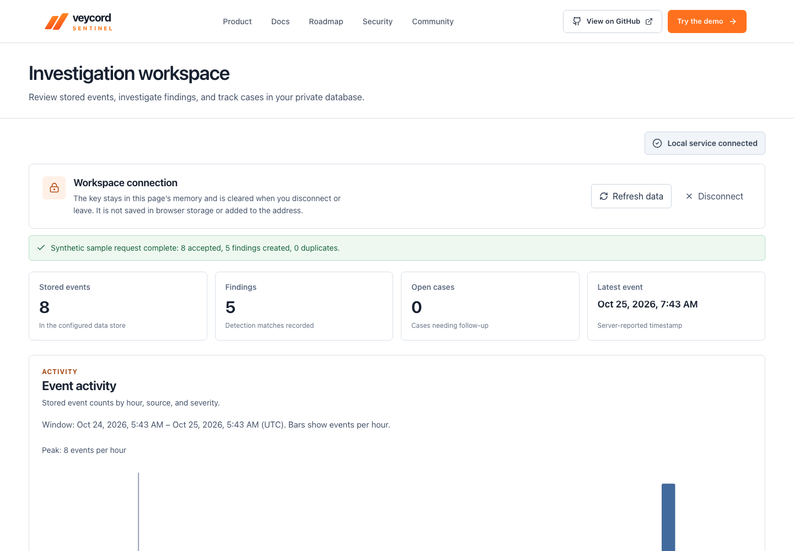

# Veycord Sentinel

[](https://github.com/NathanMabasa/veycord-sentinel/actions/workflows/verify.yml)

A security investigation workbench in early development. The current application offers a synthetic analyst demo, public product/docs pages, a read-only local Hono API, and an optional private PostgreSQL workspace. It is not ready for real telemetry.



## Run locally

Use Node.js 22+ and npm:

```sh
npm ci
npm run dev
```

Open the printed localhost URL. The Vite development server serves the console and `/api/v1` routes. `npm run build` typechecks the frontend, API and Vite configuration and compiles the Node runtime. `npm start` runs compiled JavaScript after runtime configuration. `npm run preview` serves the built UI with the synthetic API locally. A plain static upload does not include that API.

```sh
npm run test:api
python3 scripts/browser_audit.py
python3 scripts/bootstrap_audit.py
python3 scripts/navigation_audit.py
```

The browser audits need Python Playwright/Chromium and an already running Vite server. The startup audit specifically intercepts Vite development module requests, so run it against the development server. It uses a separate temporary browser context, never the user's browser profile.

## Current capabilities

- Search and inspect eight deterministic synthetic events and four starter detections.
- Resolve/reopen demo alerts; create linked cases, edit notes, close/reopen and export cases.
- Navigate grouped pages with native history/deep links, collapse the desktop rail, switch workspace routes and use Cmd/CtrlK to find a page or sample event.
- Save browser preferences/searches and choose light/dark theme. Browser storage is demo persistence, not secure data storage.
- Try the actual read-only API via `/docs/api`; see [API contract](docs/API-v1.md).

## Private workspace

The same source can connect to your own private PostgreSQL database. It includes server-configured service-key authentication, bounded ingestion/search, six deterministic rules, findings and durable cases. Visit `/workspace` after following [private setup](docs/PRIVATE-WORKSPACE.md) and [private API](docs/PRIVATE-API.md). It is disabled by default. The public demo never reads private tables. Source/schema/migrations can be published; credentials, customer records and database backups must stay private.

`npm run test:unit` checks API/detection/gateway contracts. `npm run test:db` creates a disposable local PostgreSQL cluster when `initdb`/`pg_ctl` are installed. `SENTINEL_BROWSER_AUDIT=true npm run test:db` additionally checks the built standalone service through Playwright. No existing user database is touched.

The private workspace also has real 24-hour activity analytics, event time ranges, enforced capacity, append-only operational audit, retention dry runs and encrypted backup/restore tooling. See [operations](docs/OPERATIONS.md) and the [versioned detection catalog and change policy](docs/DETECTION-RULES.md). Interactive identity/roles, collectors, complete privacy deletion/export, external audit anchoring, scheduled/offsite recovery and high-volume validation remain pending. Use synthetic data while these gates are completed. Read the [vulnerability response manual](docs/brain/03-Security/Vulnerability%20Response%20Manual.md) and [hosting decision](docs/brain/02-Architecture/Private%20Deployment%20Decision.md).

## Dashboard quality checks

The demo starts in light mode, retains a dark-mode preference, and uses one scoped event search with explicit inspection controls plus a workspace command dialog. Source counts come from the labeled fixtures. Run `npm run test:a11y` against a local Vite server for automated axe-core A/AA checks across eight dashboard pages, both themes and three widths. `python3 scripts/navigation_audit.py` adds keyboard/history checks and 32 overlay/rail accessibility states. This complements functional, keyboard and screenshot review; it does not establish WCAG conformance.

`npm run licenses:inventory` regenerates dependency notices after a reviewed lockfile change. `npm sbom --sbom-format cyclonedx` generates the dependency inventory.

## Project records

- [Current batch tickets](docs/tickets/BUILD-BATCH-006.md)
- [Integration audit and evidence](docs/audit/INTEGRATION-AUDIT.md)
- [Audit research and library choices](docs/audit/RESEARCH-AND-SELECTION.md)
- [Product brain](docs/brain/README.md)
- [Design direction](DESIGN.md)

Project source: [NathanMabasa/veycord-sentinel](https://github.com/NathanMabasa/veycord-sentinel). Forks can override the website link with `VITE_GITHUB_REPOSITORY=owner/repository`. The project is [Apache-2.0 licensed](LICENSE); dependencies and brand references retain separate terms. See [third-party notices](THIRD_PARTY_NOTICES.md), [contributing](CONTRIBUTING.md), [private security reporting](SECURITY.md) and the [release checklist](docs/release/RELEASE-CHECKLIST.md). GSAP uses its own Standard no-charge terms. This is an alpha source publication, not a supported production release.
